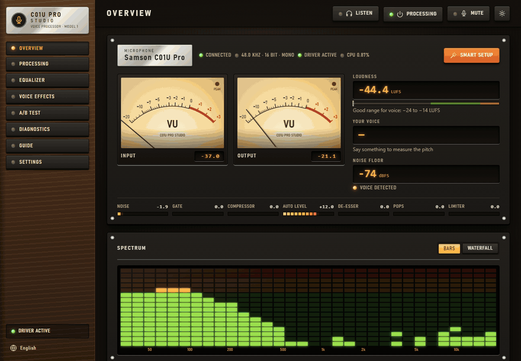
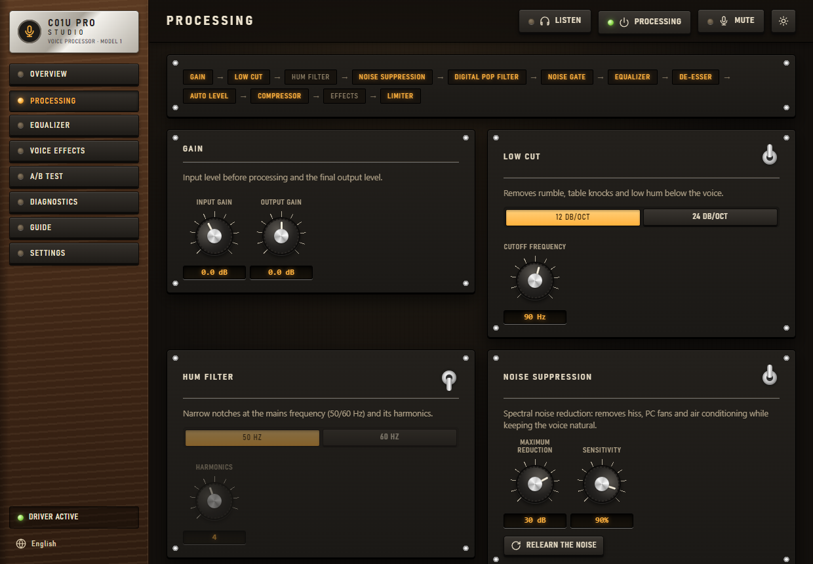
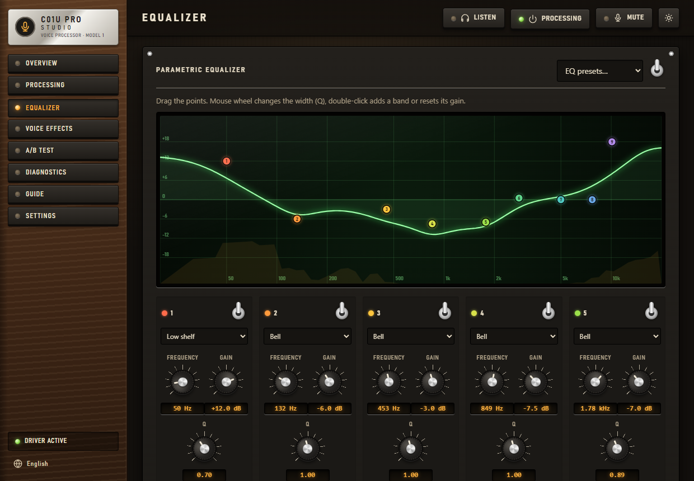
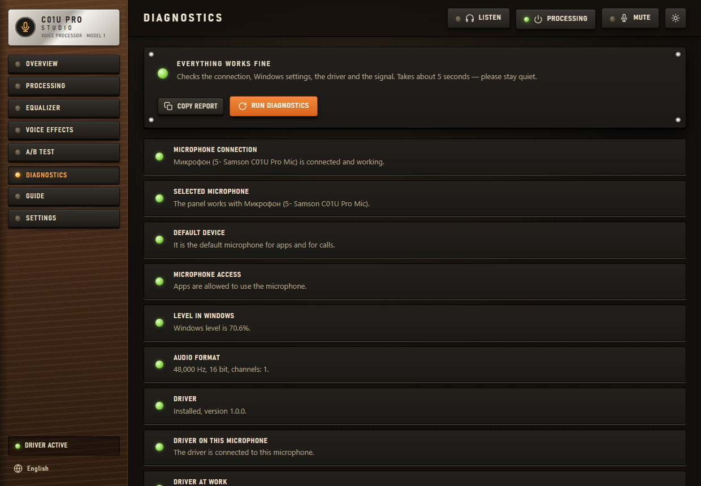
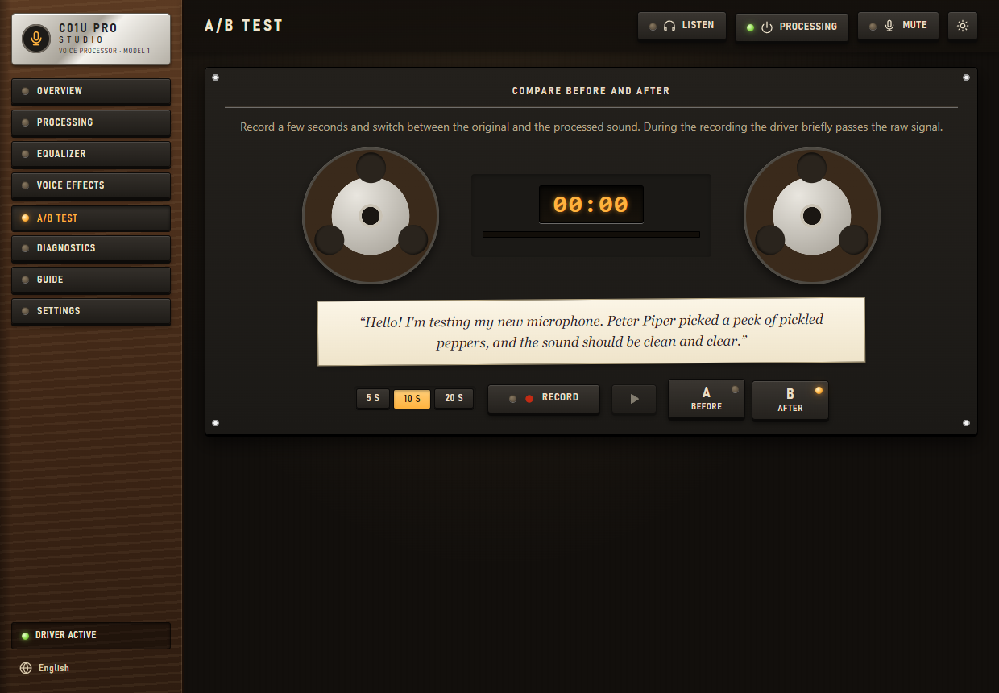

# 🎙 C01U Pro Studio — voice processing driver for the Samson C01U Pro

**English** · [Русский](README.ru.md)

**C01U Pro Studio is a free, unofficial driver for the Samson C01U Pro USB microphone on Windows.** It cleans up and
polishes your voice in every app at once — Discord, OBS, Zoom, Telegram, games — and comes with a control panel styled
like a 1970s recording studio. No neural networks: under 1% of one CPU core and about 12 ms of latency.

[](https://github.com/Agrysif/c01u-pro-studio/releases/latest)




## Why C01U Pro Studio

- **Works in every app.** The processing runs inside the Windows audio engine as a system effect (APO), so every program
  that records from the microphone gets the processed voice. It keeps working when the panel is closed.
- **Made for the C01U Pro.** It is a sensitive condenser microphone that hears the whole room. The chain removes hiss, PC
  fans and hum, closes the mic in pauses, softens pops and sharp "s" sounds and keeps the level even.
- **Light.** Under 1% of one CPU core, about 12 ms of latency. The panel in the tray takes under 10 MB of memory.
- **Easy.** *Smart setup* listens to your room and your voice for 15 seconds and tunes the whole chain. *Diagnostics*
  finds typical problems and fixes them in one click.
- **Updates itself.** New versions come from GitHub Releases, are checked with the author's digital signature and
  install while nobody uses the microphone.

## Features

| | What it does |
|---|---|
| 🔇 **Noise suppression** | Spectral algorithm without neural networks: removes hiss, PC and air-conditioner noise without eating the voice |
| 🚪 **Noise gate** | Closes the mic in pauses; the automatic threshold follows the room noise |
| 💨 **Digital pop filter** | Catches air bursts on "p", "b", "t" |
| 🐍 **De-esser** | Softens sharp "s" and "sh" |
| 🔌 **Hum filter** | Narrow notches at 50/60 Hz and their harmonics |
| 🎚 **Equalizer** | 10 bands with draggable points over the live spectrum, plus quick *Warmth*, *Clarity* and *Air* knobs |
| 📏 **Auto level, compressor, limiter** | Even loudness when you lean away, a dense voice, no clipping on a sudden shout |
| 🤖 **Voice effects** | Robot, walkie-talkie, telephone, deep and high voice, echo, hall |
| 🎧 **Listen to yourself** | Monitoring of the processed or the raw voice in headphones |
| 🔁 **A/B test** | Record a phrase and switch between "before" and "after" |
| 📊 **Meters** | VU meters, LUFS loudness, voice pitch, LED spectrum and waterfall |
| 🩺 **Diagnostics** | Checks the mic, privacy switches, level, format, driver, noise, hum and clipping, with one-click fixes |
| ⌨️ **Hotkey** | **Ctrl + Alt + M** mutes the microphone in any app |

**Presets:** C01U Pro Signature · Natural · Podcast · Stream & games · Voice chat · Singing · ASMR / whisper ·
Radio host · No processing · and your own.

| Processing chain | Equalizer |
| --- | --- |
|  |  |
| **Diagnostics** | **A/B test** |
|  |  |

More screenshots: [docs/screenshots](docs/screenshots).

## Download and install

1. Download `C01UProStudio-<version>.exe` from **[Releases](https://github.com/Agrysif/c01u-pro-studio/releases/latest)**.
2. Run it. Windows may show *"Windows protected your PC"* because the app has no paid code signing certificate:
   click **More info → Run anyway**.
3. The panel opens. Press **Install driver** and confirm the Windows prompt. The Windows audio service restarts, so the
   sound disappears for a couple of seconds.
4. Done. The panel starts with Windows and lives in the tray: click the icon to open it.

**Requirements:** Windows 8, 8.1, 10 or 11, 64-bit; a Samson C01U Pro. You can attach the driver to another microphone in
*Settings*, but the presets are tuned for the C01U Pro. Tested on Windows 11 25H2; the Windows 8 and 10 builds have not
been tried on real systems yet, reports are welcome.

What the installer changes (the original values are backed up and restored on removal):

- copies the app to `C:\Program Files\C01U Pro Studio`;
- registers the processing module and attaches it to every Samson microphone Windows knows;
- allows unsigned audio effects to load (`DisableProtectedAudioDG`, the same setting Equalizer APO uses);
- turns on Windows *Audio enhancements* for the microphone: without them Windows skips every audio effect;
- adds the update task, autostart and an entry in *Apps*.

To remove it: *Settings → Remove driver* in the panel, or *Windows Settings → Apps*.

## How to use

1. Open the panel from the tray and press **Smart setup**: stay silent for 4 seconds, then talk for 7 seconds.
2. Or pick a preset on the *Overview* page.
3. Put on headphones and press **Listen** to hear yourself. Use the *A/B test* to compare "before" and "after".
4. In Discord, Zoom, Teams or Telegram choose *Samson C01U Pro* and turn their own noise suppression off or to "Low":
   the driver already does it, and double processing makes the voice worse.

Apps that use exclusive or ASIO mode bypass Windows effects. For them, *Settings → Routing* sends the processed voice
to a virtual cable.

## Automatic updates

- The installer adds a Windows Task Scheduler task. Every few hours it checks the latest release on GitHub.
- The release description is signed with the author's **ECDSA P-256** key. The app checks the signature, then the size
  and SHA-256 of the installer, before it changes anything. A forged update is rejected even if someone gets access to
  the GitHub page.
- A new version installs while no app records from the microphone, because the audio service restart drops the sound
  for a second or two. The panel then restarts itself into the new version.
- *Settings → Updates*: turn automatic updates off, or press *Check now*.

Privacy: the app only connects to `github.com` to check for updates. The panel is served on `127.0.0.1` and is not
reachable from the network.

## Languages

English, Русский, Українська, Беларуская, Қазақша, Oʻzbekcha, Кыргызча, Тоҷикӣ, Հայերեն, Azərbaycanca, ქართული,
Română, Türkmençe, Deutsch, Français, Español, Italiano, Português, Polski, Türkçe, 中文, 日本語, 한국어, العربية, हिन्दी.

The language follows Windows and can be changed in the panel. Fixes from native speakers are welcome: the files are in
[`web/i18n`](web/i18n).

## Latency and CPU

The whole chain adds about **12 ms** of latency and takes about **0.8% of one CPU core**. On a 6-core processor that
is around 0.1% of the whole CPU.

## FAQ

**Is this a real driver?** The C01U Pro is a class-compliant USB microphone, so it keeps the standard Windows USB audio
driver. C01U Pro Studio adds an audio processing object (APO): the official Windows mechanism for sound effects that
manufacturers use for their "enhancements". There is no kernel code.

**Does the voice get processed with the panel closed?** Yes. The processing lives in the Windows audio engine and
loads its last settings by itself.

**Does it work with OBS / Discord / games?** Yes, with every app that records from the microphone through Windows
(shared mode).

**The driver stopped working after a Windows update.** Open *Diagnostics*. Windows sometimes turns *Audio enhancements*
off; the fix is one click.

**macOS / Linux?** No, the APO mechanism is Windows-only.

## Build from source

You need Visual Studio 2019/2022 or Build Tools with C++ and the Windows SDK.

```powershell
.\build.ps1 tests     # DSP tests, update core self-test, APO load test the way Windows loads it
.\build.ps1 release   # dist\C01UProStudio.exe (the panel with the web UI and the APO inside)
```

For UI work without rebuilding, set `C01U_WEB_DIR=<path to web>` and the panel serves the files from disk.

| Folder | What is inside |
|---|---|
| `src/dsp/` | Audio processing, shared by the APO and the panel |
| `src/apo/` | The APO (COM DLL loaded by `audiodg.exe`) |
| `src/app/` | Panel: tray, local web server, WASAPI, diagnostics, installer, updater |
| `src/shared/` | Parameters and shared memory between the APO and the panel |
| `web/` | The interface and translations |
| `tests/` | DSP tests, APO host test, update test |
| `tools/` | Release script, screenshot script, icon generator |
| `releases/<version>/` | Release notes |

Releasing a new version: raise the version in `src/shared/version.h`, describe it in `releases/<version>/`, commit,
then run `pwsh .\tools\release.ps1`. The script builds, tests, signs and publishes the release, and installed copies
update themselves. The signing key stays outside the repository.

## License

[MIT](LICENSE) © 2026 Agrysif.

C01U Pro Studio is an independent project. It is not affiliated with, endorsed or sponsored by Samson Technologies.
Samson and C01U Pro are trademarks of their owner and are used here only to name the supported microphone.

---

*Keywords: Samson C01U Pro driver Windows 11, C01U Pro Windows 10 driver, USB microphone noise suppression, microphone
equalizer, Windows APO, system-wide voice effects, Discord microphone noise, OBS microphone, streaming microphone setup.*
