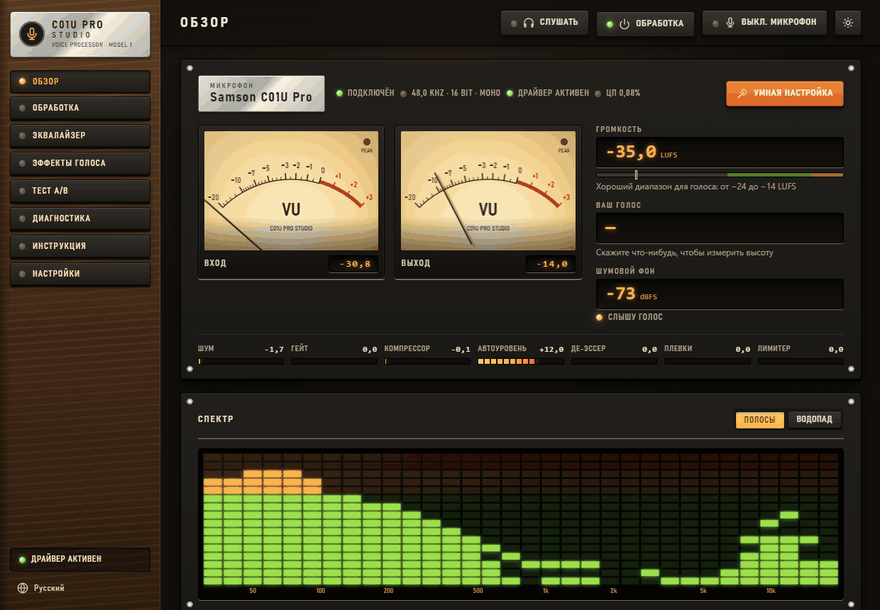
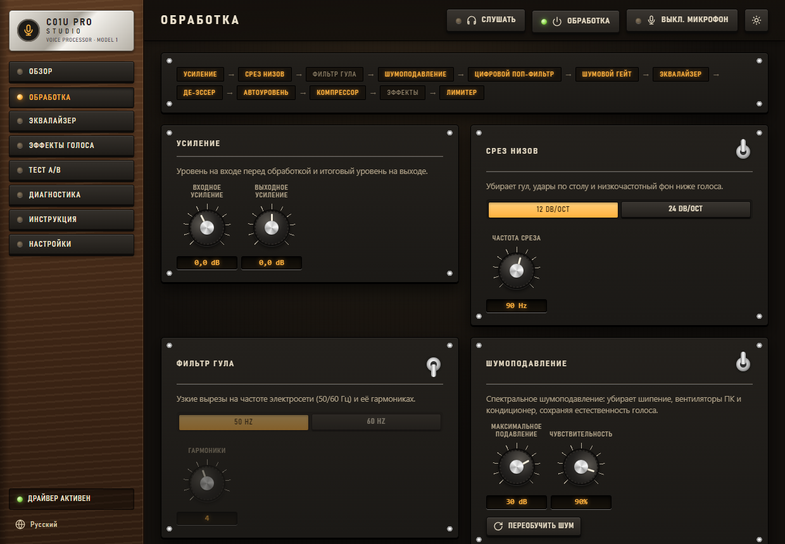
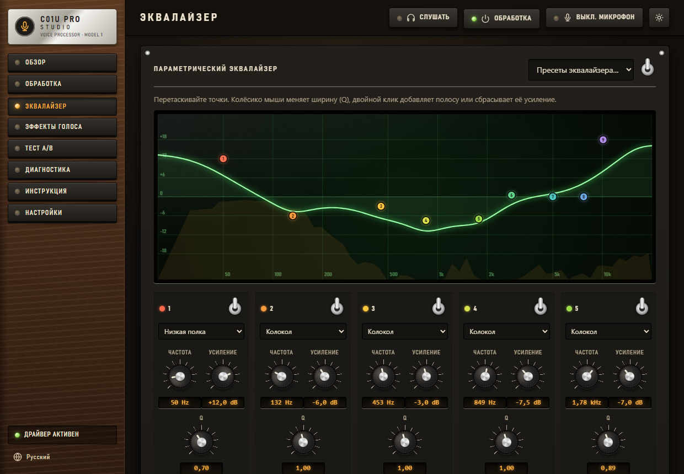
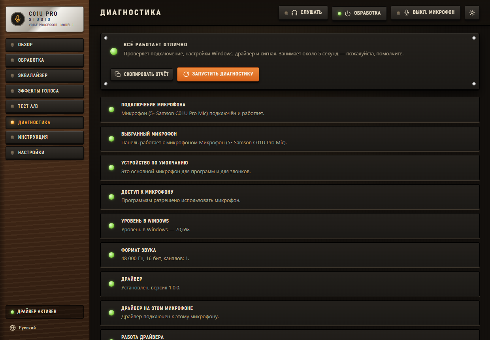
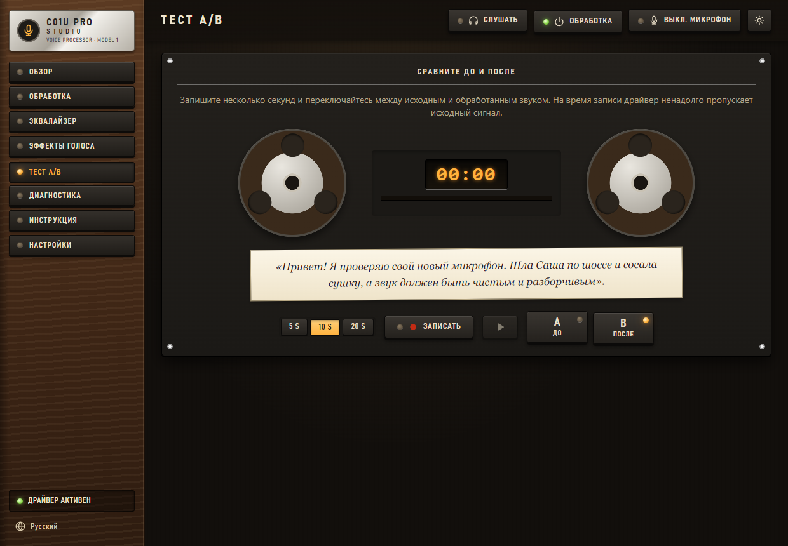

# 🎙 C01U Pro Studio — драйвер обработки голоса для Samson C01U Pro

[English](README.md) · **Русский**

**C01U Pro Studio — бесплатный неофициальный драйвер для USB-микрофона Samson C01U Pro под Windows.** Он чистит и
улучшает голос сразу во всех программах — Discord, OBS, Zoom, Telegram, играх, — а настраивается через пульт в стиле
студии звукозаписи 70-х. Без нейросетей: меньше 1% одного ядра процессора и около 12 мс задержки.

[](https://github.com/Agrysif/c01u-pro-studio/releases/latest)




## Зачем он нужен

- **Работает во всех программах.** Обработка идёт внутри звукового движка Windows как системный эффект (APO), поэтому
  улучшенный голос получает любая программа, которая пишет с микрофона. Работает и при закрытом пульте.
- **Сделан под C01U Pro.** Это чувствительный конденсаторный микрофон, он слышит всю комнату. Цепочка убирает шипение,
  шум вентиляторов и фон сети, закрывает микрофон в паузах, смягчает «плевки» и резкие «с», выравнивает громкость.
- **Лёгкий.** Меньше 1% одного ядра, задержка около 12 мс. Пульт в трее занимает меньше 10 МБ памяти.
- **Простой.** «Умная настройка» за 15 секунд слушает комнату и голос и сама подбирает всю цепочку. «Диагностика»
  находит типичные проблемы и исправляет их в один клик.
- **Обновляется сам.** Новые версии приходят с GitHub, проверяются цифровой подписью автора и ставятся, когда
  микрофоном никто не пользуется.

## Возможности

| | Что делает |
|---|---|
| 🔇 **Шумоподавление** | Спектральный алгоритм без нейросетей: убирает шипение, шум компьютера и кондиционера и не «съедает» голос |
| 🚪 **Гейт** | Закрывает микрофон в паузах; автоматический порог сам следит за шумом комнаты |
| 💨 **Цифровой поп-фильтр** | Ловит удары воздуха на «п», «б», «т» |
| 🐍 **Де-эссер** | Смягчает резкие «с» и «ш» |
| 🔌 **Фильтр гула** | Узкие вырезы на 50/60 Гц и их гармониках |
| 🎚 **Эквалайзер** | 10 полос, точки перетаскиваются прямо поверх живого спектра, плюс быстрые ручки «Тепло», «Чёткость», «Воздух» |
| 📏 **Автоуровень, компрессор, лимитер** | Ровная громкость, даже если отодвинулись; плотный голос; никаких перегрузок при крике |
| 🤖 **Эффекты голоса** | Робот, рация, телефон, низкий и высокий голос, эхо, зал |
| 🎧 **Прослушка себя** | Обработанный или исходный голос в наушниках |
| 🔁 **A/B-тест** | Запишите фразу и переключайтесь между «до» и «после» |
| 📊 **Индикаторы** | VU-стрелки, громкость в LUFS, высота голоса, LED-спектр и «водопад» |
| 🩺 **Диагностика** | Проверяет микрофон, конфиденциальность, уровень, формат, драйвер, шум, гул и перегрузки, исправляет в один клик |
| ⌨️ **Горячая клавиша** | **Ctrl + Alt + M** выключает микрофон в любой программе |

**Пресеты:** C01U Pro Signature · Естественный · Подкаст · Стрим и игры · Голосовой чат · Пение · ASMR / шёпот ·
Радиоведущий · Без обработки · и свои.

| Цепочка обработки | Эквалайзер |
| --- | --- |
|  |  |
| **Диагностика** | **A/B-тест** |
|  |  |

Остальные скриншоты: [docs/screenshots](docs/screenshots).

## Скачать и установить

1. Скачайте `C01UProStudio-<версия>.exe` со страницы **[Releases](https://github.com/Agrysif/c01u-pro-studio/releases/latest)**.
2. Запустите. Windows может показать «Windows защитил ваш компьютер»: у программы нет платного сертификата подписи.
   Нажмите **Подробнее → Выполнить в любом случае**.
3. Откроется пульт. Нажмите **«Установить драйвер»** и подтвердите запрос Windows. Служба звука перезапустится, звук
   пропадёт на пару секунд.
4. Готово. Пульт запускается вместе с Windows и живёт в трее: нажмите на значок, чтобы открыть его.

**Требования:** Windows 8, 8.1, 10 или 11, 64-бит; микрофон Samson C01U Pro. В «Настройках» драйвер можно подключить и
к другому микрофону, но пресеты подобраны под C01U Pro. Проверено на Windows 11 25H2; на Windows 8 и 10 сборка пока не
проверялась на живых системах — будем рады отчётам.

Что меняет установщик (исходные значения сохраняются и возвращаются при удалении):

- копирует программу в `C:\Program Files\C01U Pro Studio`;
- регистрирует модуль обработки и подключает его ко всем микрофонам Samson, которые знает Windows;
- разрешает загрузку неподписанных звуковых эффектов (`DisableProtectedAudioDG` — так же делает Equalizer APO);
- включает у микрофона «Улучшения звука» Windows: без них Windows пропускает любые звуковые эффекты;
- добавляет задачу обновления, автозапуск и запись в «Приложения».

Удаление: в пульте «Настройки → Удалить драйвер» или «Параметры Windows → Приложения».

## Как пользоваться

1. Откройте пульт из трея и нажмите **«Умная настройка»**: 4 секунды помолчите, затем 7 секунд говорите.
2. Или выберите пресет на странице «Обзор».
3. Наденьте наушники и нажмите **«Слушать»**. В «Тесте A/B» сравните «до» и «после».
4. В Discord, Zoom, Teams или Telegram выберите *Samson C01U Pro* и выключите их шумоподавление или поставьте «Низкое»:
   драйвер уже всё делает, а двойная обработка портит голос.

Программы в монопольном режиме или с ASIO обходят эффекты Windows. Для них «Настройки → Маршрутизация» отправляет
обработанный голос в виртуальный кабель.

## Автообновление

- Установщик добавляет задачу в Планировщик заданий Windows. Раз в несколько часов она проверяет последний выпуск на
  GitHub.
- Описание выпуска подписано ключом автора **ECDSA P-256**. Программа проверяет подпись, затем размер и SHA-256
  установщика и только потом что-то меняет. Поддельное обновление не пройдёт, даже если кто-то получит доступ к
  странице на GitHub.
- Новая версия ставится, когда с микрофона никто не пишет: перезапуск службы звука обрывает звук на секунду-две. Пульт
  после этого сам перезапускается в новой версии.
- «Настройки → Обновления»: выключить автообновление или нажать «Проверить сейчас».

Конфиденциальность: программа ходит в сеть только на `github.com` за обновлениями. Пульт работает на `127.0.0.1` и из
сети недоступен.

## Языки

English, Русский, Українська, Беларуская, Қазақша, Oʻzbekcha, Кыргызча, Тоҷикӣ, Հայերեն, Azərbaycanca, ქართული,
Română, Türkmençe, Deutsch, Français, Español, Italiano, Português, Polski, Türkçe, 中文, 日本語, 한국어, العربية, हिन्दी.

Язык выбирается по языку Windows, его можно сменить в пульте. Исправления от носителей языка приветствуются: файлы
лежат в [`web/i18n`](web/i18n).

## Задержка и нагрузка

Вся цепочка добавляет около **12 мс** задержки и занимает около **0,8% одного ядра** процессора. На 6-ядерном
процессоре это примерно 0,1% всего процессора.

## Вопросы и ответы

**Это настоящий драйвер?** C01U Pro — микрофон класса USB Audio, поэтому стандартный USB-драйвер Windows остаётся на
месте. C01U Pro Studio добавляет модуль обработки звука (APO) — официальный механизм Windows для звуковых эффектов,
через который производители делают свои «улучшения». Кода в ядре нет.

**Голос обрабатывается при закрытом пульте?** Да. Обработка живёт в звуковом движке Windows и сама загружает последние
настройки.

**Работает с OBS, Discord и играми?** Да, со всеми программами, которые пишут с микрофона через Windows (общий режим).

**После обновления Windows драйвер перестал работать.** Откройте «Диагностику». Windows иногда выключает «Улучшения
звука» — исправляется одним кликом.

**macOS / Linux?** Нет, механизм APO есть только в Windows.

## Сборка из исходников

Нужны Visual Studio 2019/2022 или Build Tools с C++ и Windows SDK.

```powershell
.\build.ps1 tests     # тесты DSP, самопроверка обновлений, тест загрузки APO так, как это делает Windows
.\build.ps1 release   # dist\C01UProStudio.exe (пульт с интерфейсом и APO внутри)
```

Для правки интерфейса без пересборки задайте `C01U_WEB_DIR=<путь к web>`: пульт будет отдавать файлы прямо с диска.

| Папка | Что внутри |
|---|---|
| `src/dsp/` | Обработка звука, общая для APO и пульта |
| `src/apo/` | APO (COM-библиотека, которую загружает `audiodg.exe`) |
| `src/app/` | Пульт: трей, локальный веб-сервер, WASAPI, диагностика, установщик, обновления |
| `src/shared/` | Параметры и общая память между APO и пультом |
| `web/` | Интерфейс и переводы |
| `tests/` | Тесты DSP, тест загрузки APO, тест обновлений |
| `tools/` | Скрипт выпуска, скрипт скриншотов, генератор иконок |
| `releases/<версия>/` | Описания выпусков |

Выпуск новой версии: поднимите версию в `src/shared/version.h`, опишите изменения в `releases/<версия>/`, закоммитьте и
запустите `pwsh .\tools\release.ps1`. Скрипт соберёт, проверит, подпишет и опубликует выпуск, а установленные копии
обновятся сами. Ключ подписи хранится вне репозитория.

## Лицензия

[MIT](LICENSE) © 2026 Agrysif.

C01U Pro Studio — независимый проект, он не связан с Samson Technologies и не одобрен ею. Samson и C01U Pro — товарные
знаки их владельца, здесь они нужны только чтобы назвать поддерживаемый микрофон.
